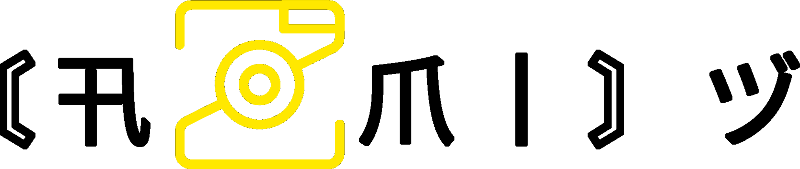

<a name="readme-top"></a>

[](https://bd.linkedin.com/in/azizulabedin)
[](https://www.instagram.com/azizulabedin/)
[](https://github.com/azizulabedinazmi)
[](http://azizulabedinazmi.is-a.dev/)
[](https://app.netlify.com/projects/azmi-gallery/deploys)

<!-- HERO SHOWCASE BANNER -->
<br />
<div align="center">
  <a href="https://azmi.is-cool.dev/">
    
  </a>
  <br /><br />

  <!-- DYNAMIC THEME-AWARE LOGO -->
  <a href="https://azmi.is-cool.dev/">
    <picture>
      <source media="(prefers-color-scheme: dark)" srcset="dist/assets/AZMI-LOGO@2x.png">
      <source media="(prefers-color-scheme: light)" srcset="dist/assets/AZMI-LOGO-Black@2x.png">
      
    </picture>
  </a>

  <h1 align="center">Azizul Abedin Azmi — Photography & Digital Art Portfolio</h1>

  <p align="center">
    An editorial fine art photography, PicsArt digital manipulation, and client proofing platform built with Tailwind CSS, Decap CMS, Netlify Functions, and the Web Audio API.
    <br />
    <br />
    <a href="https://azmi.is-cool.dev/"><strong>🌐 View Live Portfolio »</strong></a>
    ·
    <a href="https://azmi.is-cool.dev/admin/"><strong>⚡ Admin CMS »</strong></a>
    ·
    <a href="https://azmi.is-cool.dev/admin/studio.html"><strong>🛠️ Studio Suite »</strong></a>
    ·
    <a href="https://azmi.is-cool.dev/admin/proofing.html"><strong>🔒 Client Proofing Manager »</strong></a>
    ·
    <a href="http://azizulabedinazmi.is-a.dev/"><strong>💻 Developer Portfolio »</strong></a>
    <br />
    <br />
    <a href="ADMIN_SETUP.md"><strong>📖 Read the Step-by-Step Admin & PIN Setup Guide »</strong></a>
  </p>
</div>

<!-- TABLE OF CONTENTS -->
<details open>
  <summary><strong>Table of Contents</strong></summary>
  <ol>
    <li><a href="#about-the-project">About The Project</a></li>
    <li><a href="#core-features">Core Features</a></li>
    <li><a href="#admin-panel--cms">Admin Panel & Decap CMS</a></li>
    <li><a href="#studio-admin-suite">Studio Admin Suite (EXIF & WebP)</a></li>
    <li><a href="#google-drive-integration">Google Drive Storage Integration</a></li>
    <li><a href="#google-photos-live-sync">Google Photos Album Import (Admin)</a></li>
    <li><a href="#private-client-proofing">Private Client Proofing</a></li>
    <li><a href="#built-with">Built With</a></li>
    <li><a href="#getting-started">Getting Started & Local Dev</a></li>
    <li><a href="#license">License</a></li>
    <li><a href="#contact">Contact</a></li>
  </ol>
</details>

---

## 📋 About The Project <a name="about-the-project"></a>

This repository contains the complete portfolio and creative studio system for **Azizul Abedin Azmi**, showcasing:
- **Fine Art Portraiture & Human Stories**: Intimate expressions, natural light, and cultural youth photojournalism (Scouts & ECPA).
- **PicsArt Digital Art & Photo Manipulations**: 16 surreal, concept art, and high-aesthetic digital edits.
- **Private Client Proofing**: PIN-protected galleries built from uploads, Google Drive or Google Photos, where clients pick their favourites for retouching.
- **Dual Identity Connection**: Direct synergy with his software engineering portfolio at [azizulabedinazmi.is-a.dev](http://azizulabedinazmi.is-a.dev/).

---

## ✨ Core Features <a name="core-features"></a>

- **🎨 55+ Curated Works**: Complete dataset of portraits, street stories, botanical studies, and restored PicsArt masterworks.
- **🎞️ Cinematic Hero Filmstrip Marquee**: Auto-scrolling, infinite continuous filmstrip highlight reel in the hero section.
- **🎭 3D Perspective Tilt & Scroll Reveal**: Cards tilt dynamically based on cursor movement (`.tilt-card`) with subtle glare and smooth entry animations (`IntersectionObserver`).
- **🌓 Dark / Light Theme Engine**: Instant theme switcher with memory persistence (`localStorage`) and smooth transitions (`T` key).
- **🔊 Synthesized DSLR Shutter Audio & Camera Flash**: Real-time mechanical camera click powered by the browser's Web Audio API with zero audio files, plus an optional screen flash burst (`S` key).
- **❤️ Client Moodboard & Favorites Drawer**: Visitors shortlist works with a heart click (♡), view their selection in a sliding glass drawer, and click **"Inquire with this Moodboard"** to pre-fill inquiry forms automatically.
- **✨ Fullscreen Zen Exhibition Mode**: Distraction-free digital gallery exhibition with ambient background lighting and auto-play slideshow (`Z` key).
- **⚡ Live Search & Category Filtering**: Instantly filter between *All Works*, *Portraits*, *Digital Art & PicsArt*, *Events & Street*, *Nature & Details*, *Curated Series*, and *My Moodboard*.

<p align="right">(<a href="#readme-top">back to top</a>)</p>

---

## ⚡ Admin Panel & Decap CMS <a name="admin-panel--cms"></a>

Manage your portfolio without writing a single line of code!

- **URL**: `https://azmi.is-cool.dev/admin/`
- **Powered by**: Decap CMS (formerly Netlify CMS) via Git Gateway.
- **Detailed Setup Guide**: See [ADMIN_SETUP.md](ADMIN_SETUP.md) for full instructions on enabling Identity, user invitations, and setting your password.
- **How it works**:
  1. Go to your Netlify dashboard → **Settings** → **Identity** → Enable **Netlify Identity**.
  2. Set registration to **Invite only**.
  3. Enable **Git Gateway** under **Services** → **Git Gateway**.
  4. Invite your own email address in the Identity tab.
  5. Accept the invite in your email and create your password.
  6. Visit `https://azmi.is-cool.dev/admin/`, log in with your credentials.
  7. Add new photos, change categories, update camera gear, or reorder items.
  8. Click **Publish** — Netlify automatically commits the changes to GitHub and redeploys the live site in ~15 seconds.

<p align="right">(<a href="#readme-top">back to top</a>)</p>

---

## 🛠️ Studio Admin Suite (EXIF & WebP) <a name="studio-admin-suite"></a>

Located at `https://azmi.is-cool.dev/admin/studio.html`:

1. **🔁 Visual Drag-and-Drop Reordering**:
   - Live visual grid of all portfolio cards.
   - Drag and drop cards to change the display order on your homepage.
   - Click **Save / Copy Updated JSON** or **Download JSON** to export `dist/gallery-data.json`.
2. **📷 Smart Auto-EXIF Reader**:
   - Drag and drop any raw camera JPEG (from Canon, Sony, Nikon, etc.).
   - Automatically extracts Camera Body, Lens, Aperture (`f/1.8`), Shutter Speed (`1/640s`), and ISO via `exifr`.
   - Pre-fills all metadata fields automatically.
3. **⚡ In-Browser WebP Compressor**:
   - Compresses large 20MB+ camera files directly in the browser down to ~600KB WebP files (up to 96% size savings).
   - Generates a ready-to-use gallery entry object.

<p align="right">(<a href="#readme-top">back to top</a>)</p>

---

## ☁️ Google Drive Storage Integration <a name="google-drive-integration"></a>

Host your photographs on Google Drive with two flexible options:

### 1. Direct Google Drive File IDs (Zero Backend)
Upload photos to Google Drive, set sharing to *"Anyone with the link can view"*, and use either format in your gallery data or admin panel:
- Share link: `https://drive.google.com/file/d/1A2B3C4D5E.../view`
- Or File ID: `1A2B3C4D5E...`

The site automatically converts it into a high-speed Google CDN link:
```
https://lh3.googleusercontent.com/d/1A2B3C4D5E...=w1600
```

### 2. Automated Google Drive Folder Sync (Serverless Function)
- Serverless endpoint: `/.netlify/functions/gdrive-sync?folderId=YOUR_FOLDER_ID&apiKey=YOUR_API_KEY`
- Reads all images in a Google Drive folder and returns structured gallery JSON automatically.
- Pass batch IDs with zero API key needed: `/.netlify/functions/gdrive-sync?fileIds=ID1,ID2,ID3`.

<p align="right">(<a href="#readme-top">back to top</a>)</p>

---

## 📸 Google Photos Album Import (Admin) <a name="google-photos-live-sync"></a>

Pull photos from a public Google Photos shared album into the portfolio. This is an **admin-only workflow**: there is no sync button or URL parameter on the public site, so visitors can't load outside albums into the gallery.

1. In Google Photos, open an album → **Share** → **Create link**.
2. Open the **Studio Suite** (`/admin/studio.html`) → **Google Drive & Google Photos** tab.
3. Paste the album link and click **Fetch Album Photos**.
4. Click **Copy As Gallery JSON**, pick the photos you want, and add them to `dist/gallery-data.json` (or through Decap CMS). Commit, and Netlify redeploys.

Behind the scenes the Studio calls `/.netlify/functions/google-photos-album?albumUrl=...`. The function only accepts `photos.app.goo.gl` / `photos.google.com` links.

<p align="right">(<a href="#readme-top">back to top</a>)</p>

---

## 🔒 Private Client Proofing <a name="private-client-proofing"></a>

Build a private gallery for each shoot and let the client pick their favourites.

- **Proofing Manager** (`/admin/proofing.html`, Netlify Identity login): create a session per client with a title, message, PIN, max picks, expiry date and optional downloads.
- **Three photo sources**: upload straight from your computer (resized to WebP in the browser), paste Google Drive links (or a whole folder with `GDRIVE_API_KEY`), or import a Google Photos shared album. Mix them and drag to reorder.
- **Private by design**: sessions, PINs, uploads and picks live in Netlify Blobs, not in this public repo. The PIN is checked on the server, uploaded photos are served only through short-lived signed links, and repeated wrong PINs lock the gallery for 15 minutes.
- **Client gallery** (`/client/<code>`): masonry grid, full-screen viewer with swipe and arrow keys, ♡ picking with a live counter, an optional note, and resubmitting until the gallery closes.
- **Picks in your dashboard**: see chosen frames, the client's note and submit time; copy or download the list.

Full walkthrough: [ADMIN_SETUP.md → Client Proofing Manager](ADMIN_SETUP.md#5-client-proofing-manager).

<p align="right">(<a href="#readme-top">back to top</a>)</p>

---

## 🛠️ Built With <a name="built-with"></a>

- **HTML5 & Semantic Markup**: Structured for SEO and accessibility.
- **Tailwind CSS**: Modern utility-first styling with dark/light variables.
- **Vanilla JavaScript (ES6+)**: Zero bulky frameworks, high frame-rate performance.
- **Decap CMS**: Git-based headless content management system.
- **Netlify Functions + Netlify Blobs**: private client proofing storage, Google Photos album import and Google Drive folder sync.
- **Web Audio API**: Synthetic mechanical DSLR shutter sound.
- **exifr**: Client-side EXIF metadata parsing.
- **Fancybox v5**: Lightbox presentation.

<p align="right">(<a href="#readme-top">back to top</a>)</p>

---

## 🎯 Getting Started & Local Dev <a name="getting-started"></a>

### 1. Clone the Repository
```bash
git clone https://github.com/azizulabedinazmi/photography-portfolio.git
cd photography-portfolio
```

### 2. Build the fast-loading images (optional locally, automatic on Netlify)
Every deploy runs `node scripts/build-images.js && node scripts/build-seo.js`. The first creates small WebP copies of each photo (480/960/1600px, about 20× smaller than the originals) in `dist/assets/Photography/_web/`; the second updates the sitemap and search data. To see the same thing locally:
```bash
npm install
node scripts/build-images.js && node scripts/build-seo.js
```
Without this step the site still works locally; it just loads the original full-size photos.

### 3. Run Local Development Server
Any static HTTP server works:
```bash
# Python
python -m http.server 3000

# Or Node.js
npx serve .
```

### 4. Test Netlify Functions Locally (Optional)
If you have the Netlify CLI installed:
```bash
npm install
npm install -g netlify-cli
netlify dev
```
This serves both the static site and the serverless functions (`/.netlify/functions/google-photos-album` and `/.netlify/functions/gdrive-sync`) at `http://localhost:8888`.

<p align="right">(<a href="#readme-top">back to top</a>)</p>

---

## 📜 License <a name="license"></a>

Distributed under the GPL-3.0 License. See [LICENSE](LICENSE) for more information.

---

## 📧 Contact & Connect <a name="contact"></a>

- **Azizul Abedin Azmi**
- **Developer Portfolio**: [http://azizulabedinazmi.is-a.dev/](http://azizulabedinazmi.is-a.dev/)
- **LinkedIn**: [https://bd.linkedin.com/in/azizulabedin](https://bd.linkedin.com/in/azizulabedin)
- **Instagram**: [@azizulabedin](https://www.instagram.com/azizulabedin/)
- **GitHub**: [@azizulabedinazmi](https://github.com/azizulabedinazmi)

<p align="right">(<a href="#readme-top">back to top</a>)</p>
