<a name="readme-top"></a>

[](https://bd.linkedin.com/in/azizulabedin)
[](https://www.instagram.com/azizulabedin/)
[](https://github.com/azizulabedinazmi)
[](https://app.netlify.com/projects/azmi-gallery/deploys)

<!-- HERO SHOWCASE BANNER -->
<br />
<div align="center">
  <a href="https://azmi.is-cool.dev/">
    
  </a>
  <br /><br />

  <!-- DYNAMIC THEME-AWARE LOGO -->
  <a href="https://azmi.is-cool.dev/">
    <picture>
      <source media="(prefers-color-scheme: dark)" srcset="dist/assets/AZMI-LOGO@2x.png">
      <source media="(prefers-color-scheme: light)" srcset="dist/assets/AZMI-LOGO-Black@2x.png">
      
    </picture>
  </a>

  <h1 align="center">Azizul Abedin Azmi — Photography & Digital Art Portfolio</h1>

  <p align="center">
    My personal photography and digital art portfolio, built with Astro, Tailwind CSS, Decap CMS, Netlify Functions and Cloudflare R2.
    <br />
    <br />
    <a href="https://azmi.is-cool.dev/"><strong>🌐 View Live Portfolio »</strong></a>
    ·
    <a href="https://azmi.is-cool.dev/admin/"><strong>⚡ Admin CMS »</strong></a>
    ·
    <a href="https://azmi.is-cool.dev/admin/studio.html"><strong>🛠️ Studio Suite »</strong></a>
    <br />
    <br />
    <a href="ADMIN_SETUP.md"><strong>📖 Read the Step-by-Step Admin Setup Guide »</strong></a>
  </p>
</div>

<!-- TABLE OF CONTENTS -->
<details open>
  <summary><strong>Table of Contents</strong></summary>
  <ol>
    <li><a href="#about-the-project">About The Project</a></li>
    <li><a href="#core-features">Core Features</a></li>
    <li><a href="#digital-art-replay">Digital Art Replay & Sync</a></li>
    <li><a href="#real-exif">Real Camera EXIF</a></li>
    <li><a href="#photo-storage">Photo Storage (Cloudflare R2)</a></li>
    <li><a href="#seo">Search Engines: One Page Per Photo</a></li>
    <li><a href="#admin-panel--cms">Admin Panel & Decap CMS</a></li>
    <li><a href="#studio-admin-suite">Admin Studio</a></li>
    <li><a href="#google-drive-integration">Google Drive Storage Integration</a></li>
    <li><a href="#google-photos-live-sync">Google Photos Album Import (Admin)</a></li>
    <li><a href="#built-with">Built With</a></li>
    <li><a href="#getting-started">Getting Started & Local Dev</a></li>
    <li><a href="#license">License</a></li>
    <li><a href="#contact">Contact</a></li>
  </ol>
</details>

---

## 📋 About The Project <a name="about-the-project"></a>

This is the personal portfolio of **Azizul Abedin Azmi**. It shows:
- **Fine Art Portraiture & Human Stories**: Intimate expressions, natural light, and cultural youth photojournalism (Scouts & ECPA).
- **Digital Art & Photo Manipulations**: 22 surreal, concept and high-aesthetic digital edits, most with a step-by-step **Replay** of how they were made.

---

## ✨ Core Features <a name="core-features"></a>

- **🎨 60 Curated Works**: Portraits, street and event stories, botanical studies, curated series and 22 digital artworks. Every count on the site is computed from the gallery data, so it never goes stale.
- **🧱 True Masonry Gallery**: Every photo keeps its real shape (no portrait-cropped landscapes). 4 columns on laptops and desktops, 3 on tablets, 2 or 1 on phones.
- **🖼️ Dedicated Art Column**: In *All Works* on wide screens, digital art runs down column 4 alongside the photos, then flows into the space below once the photos end, so every column finishes evenly.
- **▶ Edit Replay**: Digital art cards have a **Replay** button that plays the artwork's real editing steps (Original → Cutout → Add Object → … → Final) full-screen, with a step strip, autoplay, arrow keys and swipe.
- **👆 Hover Slideshow**: Hovering a series card cycles through its frames; hovering an art card plays its edit steps (mouse/trackpad only).
- **📷 Real Photo Details**: The ⓘ panel shows camera, lens, shutter, aperture, ISO and date read from the photo file itself, and real edit details (tools, filters, canvas, date) for digital art. Nothing is invented: missing values are left out.
- **🎞️ Cinematic Hero Filmstrip Marquee**: Auto-scrolling, infinite filmstrip highlight reel in the hero section.
- **🎭 3D Perspective Tilt & Scroll Reveal**: Cards tilt with the cursor (`.tilt-card`) and fade in as you scroll (`IntersectionObserver`).
- **🌓 Dark / Light Theme Engine**: Instant theme switcher remembered in `localStorage` (`T` key).
- **🔊 Synthesized DSLR Shutter Audio & Camera Flash**: A mechanical camera click made with the Web Audio API (no audio files), plus a screen flash (`S` key).
- **✨ Fullscreen Zen Exhibition Mode**: Distraction-free slideshow with ambient lighting and swipe support (`Z` key).
- **⚡ Live Search, Filters & Layouts**: Filter by *All Works*, *Portraits*, *Digital Art*, *Events & Street*, *Nature & Details* and *Curated Series*; search by name, tag or camera; switch between Grid, Editorial and Contact-sheet layouts.

<p align="right">(<a href="#readme-top">back to top</a>)</p>

---

## ▶ Digital Art Replay & Sync <a name="digital-art-replay"></a>

Each digital artwork in `dist/gallery-data.json` can be linked to its original post with a `postId` (the number at the end of the post link, e.g. `.../i/image-416248407049203`). One command then fills in the rest automatically:

```bash
npm run sync-art             # fill in missing details and replays
npm run sync-art -- --force  # refresh every replay
node scripts/build-seo.js    # regenerate dist/gallery-data.js (or run npm run build)
```

- **`editDetails`**: canvas size, date made, tools used (Cutout, Square Fit, Add Objects, Free Style, …) and filters (HDR One, Icy 1, …).
- **`replay`**: one image per editing step, used by the Replay player and the hover slideshow.
- Requests are spaced out; if the source rate-limits, the script stops, keeps what it already fetched, and can simply be run again later.
- Pieces posted without their edit history (e.g. *Celestial Mirage*) still get their edit details, just no Replay.

<p align="right">(<a href="#readme-top">back to top</a>)</p>

---

## 📷 Real Camera EXIF <a name="real-exif"></a>

`scripts/build-images.js` reads the EXIF stored in every original photo (with `sharp` + `exif-reader`) and saves it next to the WebP sizes in `dist/image-variants.js`. The site uses it for the ⓘ panel, card captions and Zen mode:

- Camera body and lens (e.g. *Canon EOS 750D · EF50mm f/1.8 STM*), shutter, aperture, ISO, focal length, date taken and editing software.
- Photos re-saved by apps that strip EXIF (e.g. Google Photos) say so honestly instead of showing made-up settings.

<p align="right">(<a href="#readme-top">back to top</a>)</p>

---

## 🔐 Photo Storage (Cloudflare R2) <a name="photo-storage"></a>

The full-size photo originals are **not stored in GitHub**. They live in a **private Cloudflare R2 bucket**, and the website never serves them:

1. On every deploy, `npm run build` downloads the originals from R2 (`scripts/photos-sync.js pull`).
2. `scripts/build-images.js` turns them into small WebP copies (480/960/1600px) and reads their EXIF.
3. Only the WebP copies are published. Any old link to an original (search engines, shared links) is redirected to its WebP copy.

### One-time setup
1. **Cloudflare dashboard → R2 → Create bucket** (keep public access **off**).
2. **R2 → Manage API tokens → Create API token** with **Object Read & Write**, limited to that bucket. Copy the *Access Key ID* and *Secret Access Key*.
3. Copy `.env.example` to `.env` (git-ignored) and fill in `R2_ACCOUNT_ID`, `R2_ACCESS_KEY_ID`, `R2_SECRET_ACCESS_KEY` and `R2_BUCKET`.
4. Add the **same four variables** in **Netlify → Site configuration → Environment variables**.

### Everyday use
```bash
npm run photos:push   # upload new or changed originals from dist/assets/Photography to R2 (verified after upload)
npm run photos:pull   # download originals you don't have locally (e.g. on a fresh clone)
npm run art:sync      # copy any new digital-art / Replay images into R2 (art/ folder) and download them
# add --dry-run to the photos commands to preview without transferring anything
```

> **Digital art is self-hosted too.** Every artwork and Replay step image is mirrored into the same bucket under `art/`; the build downloads them and publishes WebP copies, so the site never loads images from the original host.

> New photos added through Decap CMS are committed to `dist/assets/Photography` as before. Run `npm run photos:push` afterwards to copy them to R2.
> If R2 isn't configured, the build uses whatever originals are on disk, and on Netlify it **fails with a clear message** instead of publishing a site with no photos.

<p align="right">(<a href="#readme-top">back to top</a>)</p>

---

## 🔎 Search Engines: One Page Per Photo <a name="seo"></a>

Each photo and artwork has its **own page** at `/photo/<title-slug>/` (`src/pages/photo/[slug].astro`), titled and described only by **its own subject and tags**. The sitemap lists every image under its own page, so a search for a person's name shows *their* photo.

- The **only** image tied to the owner's name is `dist/assets/Avatar.png` (About page + `Person` schema).
- The homepage uses `noimageindex`, so gallery thumbnails there are not filed under the owner's name.
- After deploying, resubmit `https://azmi.is-cool.dev/sitemap.xml` in Google Search Console. Google takes days to weeks to re-crawl and drop the old associations.

<p align="right">(<a href="#readme-top">back to top</a>)</p>

---

## ⚡ Admin Panel & Decap CMS <a name="admin-panel--cms"></a>

Manage your portfolio without writing a single line of code!

- **URL**: `https://azmi.is-cool.dev/admin/`
- **Powered by**: Decap CMS (formerly Netlify CMS) via Git Gateway.
- **Detailed Setup Guide**: See [ADMIN_SETUP.md](ADMIN_SETUP.md) for full instructions on enabling Identity, user invitations, and setting your password.
- **How it works**:
  1. Go to your Netlify dashboard → **Settings** → **Identity** → Enable **Netlify Identity**.
  2. Set registration to **Invite only**.
  3. Enable **Git Gateway** under **Services** → **Git Gateway**.
  4. Invite your own email address in the Identity tab.
  5. Accept the invite in your email and create your password.
  6. Visit `https://azmi.is-cool.dev/admin/`, log in with your credentials.
  7. Add new photos, change categories, update camera gear, or reorder items.
  8. Click **Publish** — Netlify automatically commits the changes to GitHub and redeploys the live site in ~15 seconds.

<p align="right">(<a href="#readme-top">back to top</a>)</p>

---

## 🛠️ Admin Studio <a name="studio-admin-suite"></a>

`https://azmi.is-cool.dev/admin/studio.html`, behind your Netlify Identity login (the same account as the CMS; sign-ups are closed). Every change is saved straight to GitHub as a commit, so the site rebuilds and is live in 1–2 minutes. No more copying JSON by hand.

- **📊 Dashboard**: whether your latest change is live yet (compares the live build with GitHub), counts (shown, hidden, featured, photos, art, originals in R2), and a **Needs attention** list from each build: images missing from storage, missing alt text, duplicate IDs, unused originals in R2. **Check every image loads** tests every image in your browser. Quick links to Netlify deploys, R2, Search Console, Analytics and contact-form messages.
- **🖼️ Gallery**: drag to reorder, **👁 Hide** (keeps the photo but takes it off the site: no card, no photo page, not in the sitemap), **★ Feature** (choose the photos in the homepage filmstrip; with none featured it shows the first 18), click a photo to edit its title, alt text, category, tags or series name, move it to the top, or remove it. Changes collect in a yellow bar until you press **Save & publish**.
- **⬆️ Upload**: drop photos and give each a title, alt text, category and tags. The full-size original goes **straight from your browser to the private R2 bucket** through a 15-minute signed link (`netlify/functions/admin-upload-url.js`, login required), never through GitHub. The gallery entry is saved automatically, and the build makes the WebP copies and reads the real EXIF.
- **☁️ Drive & Photos**: Google Drive link → image URL, and Google Photos shared-album lister.

Opened anywhere other than the live site (e.g. `npm run preview`), the Studio runs read-only with the local data.

### One-time setup for uploads: R2 CORS rule
Browsers may only upload to R2 from your site once the bucket allows it. In **Cloudflare → R2 → your bucket → Settings → CORS policy → Add CORS policy**, paste:

```json
[
  {
    "AllowedOrigins": ["https://azmi.is-cool.dev"],
    "AllowedMethods": ["PUT"],
    "AllowedHeaders": ["content-type"],
    "MaxAgeSeconds": 3600
  }
]
```

<p align="right">(<a href="#readme-top">back to top</a>)</p>

---

## ☁️ Google Drive Storage Integration <a name="google-drive-integration"></a>

Host your photographs on Google Drive with two flexible options:

### 1. Direct Google Drive File IDs (Zero Backend)
Upload photos to Google Drive, set sharing to *"Anyone with the link can view"*, and use either format in your gallery data or admin panel:
- Share link: `https://drive.google.com/file/d/1A2B3C4D5E.../view`
- Or File ID: `1A2B3C4D5E...`

The site automatically converts it into a high-speed Google CDN link:
```
https://lh3.googleusercontent.com/d/1A2B3C4D5E...=w1600
```

### 2. Automated Google Drive Folder Sync (Serverless Function)
- Serverless endpoint: `/.netlify/functions/gdrive-sync?folderId=YOUR_FOLDER_ID&apiKey=YOUR_API_KEY`
- Reads all images in a Google Drive folder and returns structured gallery JSON automatically.
- Pass batch IDs with zero API key needed: `/.netlify/functions/gdrive-sync?fileIds=ID1,ID2,ID3`.

<p align="right">(<a href="#readme-top">back to top</a>)</p>

---

## 📸 Google Photos Album Import (Admin) <a name="google-photos-live-sync"></a>

Pull photos from a public Google Photos shared album into the portfolio. This is an **admin-only workflow**: there is no sync button or URL parameter on the public site, so visitors can't load outside albums into the gallery.

1. In Google Photos, open an album → **Share** → **Create link**.
2. Open the **Studio Suite** (`/admin/studio.html`) → **Google Drive & Google Photos** tab.
3. Paste the album link and click **Fetch Album Photos**.
4. Click **Copy As Gallery JSON**, pick the photos you want, and add them to `dist/gallery-data.json` (or through Decap CMS). Commit, and Netlify redeploys.

Behind the scenes the Studio calls `/.netlify/functions/google-photos-album?albumUrl=...`. The function only accepts `photos.app.goo.gl` / `photos.google.com` links.

<p align="right">(<a href="#readme-top">back to top</a>)</p>

---

## 🛠️ Built With <a name="built-with"></a>

- **Astro 7**: Static site generator; pages and components live in `src/` and build to `dist_site/`.
- **Tailwind CSS v4**: Utility-first styling with dark/light variants (via `@tailwindcss/vite`).
- **Vanilla JavaScript (ES6+)**: Gallery, masonry, Replay player and interactions in `public/dist/portfolio-smart.js`, with no client-side framework.
- **sharp + exif-reader**: WebP image sizes and real EXIF at build time.
- **Decap CMS**: Git-based headless content management.
- **Netlify Functions**: Google Photos album import and Google Drive folder sync for the Studio.
- **Cloudflare R2 (aws4fetch)**: Private storage for photo originals and digital-art images.
- **Web Audio API**: Synthetic mechanical DSLR shutter sound.
- **exifr**: In-browser EXIF reading in the Studio Suite.
- **Fancybox v5**: Lightbox presentation.

<p align="right">(<a href="#readme-top">back to top</a>)</p>

---

## 🎯 Getting Started & Local Dev <a name="getting-started"></a>

Requires **Node.js 20+**.

### 1. Clone and install
```bash
git clone https://github.com/azizulabedinazmi/photography-portfolio.git
cd photography-portfolio
npm install
```

### 2. Run the dev server
```bash
npm run dev
```
Open **http://localhost:4321**. The home, about, contact and photo pages, plus `/admin/` and everything under `/dist/`, are served with live reload.

The photo originals are not in git. To get them, set up `.env` (see [Photo Storage](#photo-storage)) and pull them, then generate the WebP copies and EXIF:
```bash
npm run photos:pull
node scripts/build-images.js && node scripts/build-seo.js
```

### 3. Production build and preview
```bash
npm run build     # pull originals from R2 + images + SEO data + Astro build + copy into dist_site/
npm run preview   # serves dist_site/ at http://localhost:4321
```
Netlify runs the same `npm run build` on every push to `main` and publishes `dist_site/` (see `netlify.toml`).

### 4. Test Netlify Functions Locally (Optional)
```bash
npm install -g netlify-cli
netlify dev
```
This serves the site together with the serverless functions (`/.netlify/functions/google-photos-album` and `/.netlify/functions/gdrive-sync`) at `http://localhost:8888`.

### 5. Project layout
```
src/                     Astro pages (incl. photo/[slug] pages), layout, components and lib/photos.ts
public/dist/             Browser script (portfolio-smart.js), served as-is
dist/gallery-data.json   Gallery content (edited by Decap CMS)
dist/assets/             Logos and icons; Photography/ and Art/ hold originals locally (not in git, stored in R2)
scripts/                 photos-sync, art-sync + r2 (R2 storage), build-images, build-seo, copy-assets, build-info (Studio dashboard report), fetch-replays (sync-art), build-banner
admin/                   Admin CMS and Studio Suite
netlify/functions/       Serverless functions
```

<p align="right">(<a href="#readme-top">back to top</a>)</p>

---

## 📜 License <a name="license"></a>

Distributed under the GPL-3.0 License. See [LICENSE](LICENSE) for more information.

---

## 📧 Contact & Connect <a name="contact"></a>

- **Azizul Abedin Azmi**
- **LinkedIn**: [https://bd.linkedin.com/in/azizulabedin](https://bd.linkedin.com/in/azizulabedin)
- **Instagram**: [@azizulabedin](https://www.instagram.com/azizulabedin/)
- **GitHub**: [@azizulabedinazmi](https://github.com/azizulabedinazmi)

<p align="right">(<a href="#readme-top">back to top</a>)</p>
